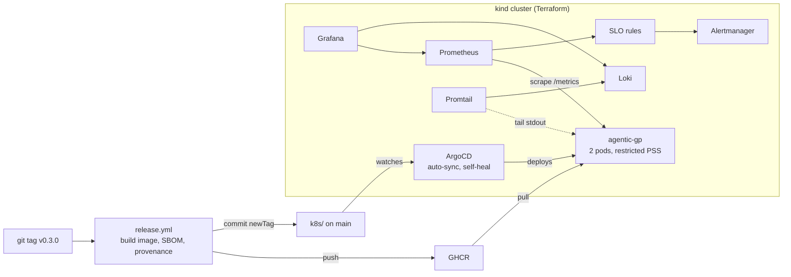

# Agentic Golden Path

A paved road that takes an **agentic (LLM-backed) microservice** from
`git push` to a running, observable, policy-checked service, without anyone
doing those steps by hand.

The app in `app/` is deliberately small (a FastAPI service that mimics a
Bedrock-backed procurement agent). **The platform around it is the point**:
infrastructure as code, CI/CD, GitOps, security gates, SLOs and alerting.

It runs on two tracks that share the same app, image, dashboard and policies:

| | Local Kubernetes track | AWS track |
|---|---|---|
| Runs on | kind on your laptop, free | ECS Fargate, ALB, RDS, Redis |
| Provisioned by | Terraform (`infra/local-kind`) | Terraform (`infra/envs/dev`, `prod`) |
| Deployed by | ArgoCD (GitOps) | GitHub Actions + ECS circuit breaker |
| Observed with | Prometheus, Alertmanager, Grafana, Loki | CloudWatch alarms + SNS |
| Start with | `make k8s-up` | `make plan ENV=dev` (needs an AWS account) |

---

## Local Kubernetes track

### Architecture



### Prerequisites (WSL2 / Ubuntu)

Docker Desktop with WSL integration enabled, then:

```bash
# kubectl
curl -LO "https://dl.k8s.io/release/$(curl -Ls https://dl.k8s.io/release/stable.txt)/bin/linux/amd64/kubectl"
sudo install kubectl /usr/local/bin/ && rm kubectl
# kind
curl -Lo kind https://kind.sigs.k8s.io/dl/v0.24.0/kind-linux-amd64 && sudo install kind /usr/local/bin/ && rm kind
# helm
curl -fsSL https://raw.githubusercontent.com/helm/helm/main/scripts/get-helm-3 | bash
```

Terraform is optional (the setup falls back to `kind create cluster`).
Conftest is optional (only for `make policy-test` / `make k8s-validate`).

### Run it

```bash
make k8s-up        # ~5-8 minutes on first run
```

`scripts/setup.sh` is idempotent and does, in order: create the cluster →
build the image and load it into kind → install kube-prometheus-stack → install
Loki → apply `k8s/` → install ArgoCD and register the app → start
port-forwards → verify. Every kubectl and helm call is pinned to the
`kind-agentic-gp` context, so other clusters in your kubeconfig are never
touched.

| Service | URL | Login |
|---|---|---|
| App | http://localhost:8090 (`/docs` for the API UI) | |
| Grafana | http://localhost:3030 | admin / admin |
| Prometheus | http://localhost:9090/alerts | |
| Alertmanager | http://localhost:9093 | |
| ArgoCD | https://localhost:8443 | admin / printed by setup |

`make k8s-status` shows pods, the running image, ArgoCD sync state and the
alerts firing right now. `make k8s-down` deletes the cluster.

### The 10-minute demo

```bash
# terminal 1: traffic, so the graphs and alerts have data
make k8s-load

# terminal 2
make chaos-errors     # 30% of /agent calls fail
                      # Grafana: error ratio jumps over the 0.5% SLO line
                      # ~3 min: AgentHighErrorRate fires (critical) in Alertmanager
                      # Grafana logs panel: the failing requests, as JSON, from Loki
make chaos-off        # recover; ArgoCD self-heal is switched back on

make chaos-latency    # +1.5 s per call -> p95 crosses 1 s -> AgentHighLatencyP95
make chaos-off

make chaos-kill       # delete a pod: ReplicaSet replaces it, PDB keeps 1 serving
make chaos-outage     # scale to 0 -> AgentAllReplicasDown (critical)
make chaos-off
```

**GitOps drift correction:** with self-heal on, try
`kubectl --context kind-agentic-gp -n agentic-gp scale deploy/agentic-gp --replicas=5`
and watch ArgoCD put it back to 2 within seconds. Git is the source of truth.

### Shipping a version

```bash
make release VERSION=0.3.0
```

The tag triggers `release.yml`: it builds the image with an SBOM and
provenance attestation, pushes it to GHCR, commits the new tag to
`k8s/kustomization.yaml`, and creates a GitHub Release. ArgoCD sees the
commit and rolls the Deployment (`maxUnavailable: 0`, so capacity never
drops). Make the GHCR package public once (GitHub → Packages → Package
settings) so the cluster can pull it.

---

## Docker-only quickstart

```bash
make test          # unit tests
make run           # from source on :8000, auto-reload
make docker-run    # the built image on :8000
make observe       # Compose: app + Prometheus (:9090) + Grafana (:3000)
```

The Compose Grafana comes up with the same SLO dashboard already loaded.

---

## AWS track

```
   Internet ──80──▶ ALB (public subnets)
                     │
                     ▼
            ECS Fargate service (private subnets)
              FastAPI agent, rolling deploy with circuit breaker
              task role: bedrock:InvokeModel (scoped)
                     │
          ┌──────────┴──────────┐
          ▼                     ▼
   RDS Postgres (encrypted)   ElastiCache Redis (encrypted)

   Secrets Manager: DB password      CloudWatch SLO alarms → SNS
```

One-time bootstrap: an S3 bucket for Terraform state and a GitHub OIDC role.
Fill in the `REPLACE-ME` values in `infra/envs/*/backend.tf`, add the
`AWS_PLAN_ROLE_ARN` / `AWS_DEPLOY_ROLE_ARN` secrets, and set the repository
variable `AWS_ENABLED=true`. Until then the AWS jobs are skipped and CI stays
green.

```bash
make plan ENV=dev          # see the plan
make plan-policy ENV=dev   # plan + run the policy gate locally
```

Merging to `main` deploys dev (`deploy.yml`); `prod` sits behind a GitHub
Environment approval.

---

## CI: what every pull request checks

| Job | Blocks merge on |
|---|---|
| App lint & tests | ruff findings, failing pytest |
| Image build & Trivy | fixable HIGH/CRITICAL CVEs |
| gitleaks | committed secrets |
| Terraform | `fmt` drift, `validate` errors in all three roots |
| Policy tests | Rego formatting, failing policy unit tests |
| Kubernetes manifests | schema errors (kubeconform), security policy violations |
| Alert rules | invalid PromQL, alert unit tests, invalid Alertmanager config |
| shellcheck | script bugs |
| AWS plan + policy | Terraform policy violations (only with `AWS_ENABLED`) |

Checkov runs in report-only mode because the demo knowingly defers some
hardening (see below); the rules this project enforces are written as code
in `policy/`.

### Policy as code (`policy/`)

- `terraform.rego`: no public S3, no `Action:*` on `Resource:*`, encrypted data
  stores, Environment tag.
- `k8s.rego`: non-root, no privilege escalation, all capabilities dropped,
  pinned image tags, CPU/memory requests and limits, liveness and readiness
  probes.
- `*_test.rego`: unit tests for both (`make policy-test`).

The Kubernetes rules target the failure classes that are common in
hand-written and LLM-generated manifests. The cluster enforces the same
baseline from the other side: the `agentic-gp` namespace runs the
`restricted` Pod Security Standard, so a pod that breaks these rules is
rejected by the API server even if it gets past CI.

---

## SLOs and alerts

**SLO:** 99.5% of `/agent` requests succeed and p95 latency stays under 1 s.

| Alert | Fires when | Severity |
|---|---|---|
| AgentHighErrorRate | > 5% errors for 2 min | critical |
| AgentErrorBudgetBurn | 1 h **and** 5 m error ratio > 14.4 × budget | warning |
| AgentHighLatencyP95 | p95 > 1 s for 2 min | warning |
| AgentAllReplicasDown | no pod scrapeable for 1 min | critical |
| AgentReplicaDown | a pod not scrapeable for 1 min | warning |

The alerts have unit tests (`observability/tests/alert-rules.test.yaml`,
`make alert-test`): promtool replays synthetic healthy, failing, slow and
down traffic and asserts exactly which alerts fire, so a broken threshold
fails CI instead of failing silently in production.

The SLIs are recording rules, computed once and reused by alerts and
dashboards. Alertmanager inhibition keeps it to one page per incident: while
AgentAllReplicasDown fires, the per-pod and SLO warnings are suppressed, and
AgentHighErrorRate suppresses the budget-burn warning it implies. On AWS the same SLO is expressed as CloudWatch alarms on
ALB metrics.

---

## Repository layout

```
app/                    FastAPI service, Dockerfile, tests
k8s/                    kustomize: namespace, deployment, service, PDB,
                        ServiceMonitor, PrometheusRule, dashboard
argocd/                 ArgoCD Application
infra/local-kind/       Terraform for the kind cluster (+ plain kind config)
infra/modules/          AWS: network, ecs-service, data, observability
infra/envs/dev, prod/   AWS environments with S3 remote state
observability/k8s/      Helm values: kube-prometheus-stack, Loki
observability/compose/  Prometheus + Grafana provisioning for Compose
observability/tests/    alert rule unit tests (promtool)
policy/                 Rego policies and their unit tests
scripts/                setup, teardown, status, load, chaos, test-alerts
.github/workflows/      ci.yml, release.yml, deploy.yml
```

---

## Intentionally simplified

These are the next steps, not oversights:

- **AWS:** the ALB is HTTP:80 (production wants ACM + HTTPS and a redirect);
  one NAT gateway (production wants one per AZ); no autoscaling yet; on a
  brand-new environment the ECR repo must exist before the first image push
  (`terraform apply -target=module.service.aws_ecr_repository.this` once).
- **Local:** Loki uses `loki-stack` with filesystem storage and Prometheus
  keeps 6 h of data. Production would use the `grafana/loki` chart with object
  storage, Alloy instead of Promtail, and longer retention. Grafana's admin
  password is `admin`.
- **App:** Bedrock calls are mocked (`MOCK_LLM=true`); `/ready` does not yet
  check Postgres/Redis.
- **Next layer:** OpenTelemetry tracing, HPA on request latency, and signing
  images with cosign and verifying signatures at admission.

---

*Stack: Python/FastAPI · Docker · Terraform · kind · Kubernetes · kustomize ·
ArgoCD · Helm · Prometheus · Alertmanager · Grafana · Loki · GitHub Actions ·
GHCR · Conftest/OPA · Trivy · gitleaks · Checkov · kubeconform · AWS (VPC, ECS
Fargate, ALB, ECR, RDS, ElastiCache, Secrets Manager, CloudWatch)*
